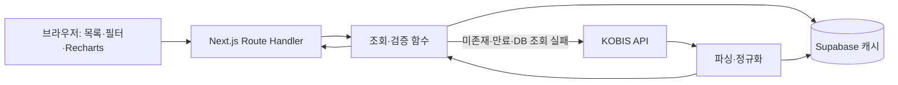

# 아키텍처 설계서

작성일: 2026-09-18 · 버전: 0.2 · 상태: 기존 설계 승인, 정규화 ERD 요구 반영

## 1. 구조와 Next.js 개념

확정 스택: Next.js App Router, TypeScript, Recharts, Supabase Postgres, Vercel, Git/GitHub. 선정 근거는 [ADR-001](ADR.md#adr-001--단일-nextjs-app-router-프로젝트) 참고.

App Router는 `app` 아래 폴더와 `page.tsx`로 화면 URL을 구성한다. `layout.tsx`는 공통 틀이다. 페이지·레이아웃은 기본 Server Component이며, 검색 입력과 차트 같은 상호작용 부분에만 Client Component를 사용한다. `app/api/.../route.ts`는 HTTP 요청을 받고 JSON을 반환하는 Route Handler다. [컴포넌트 공식 문서](https://nextjs.org/docs/app/getting-started/server-and-client-components), [Route Handler 공식 문서](https://nextjs.org/docs/app/getting-started/route-handlers)



초기에는 Server Component가 공통 틀을 제공하고 Client Component가 내부 API를 호출한다. 서버 전용 코드는 `server-only` 경계를 사용한다. 데이터 캐시 기준은 Supabase 하나로 설명하고 Next.js의 암묵적 데이터/라우트 캐시에 의존하지 않는다. 원본 fetch와 내부 API 응답은 명시적으로 캐시를 제어한다.

## 2. 제안 폴더 구조 — 아직 생성하지 않음

```text
app/
  layout.tsx, page.tsx, loading.tsx, error.tsx, globals.css
  insights/page.tsx
  api/box-office/route.ts
  _components/       # 필터, 표, 상태 안내, 차트
lib/
  kobis.ts          # 서버 전용 외부 호출·응답 검증
  supabase.ts       # 서버 전용 DB 클라이언트
  box-office.ts     # 캐시 우선 조회·폴백
  metrics.ts       # 순수 집계 함수
  validation.ts    # 날짜·파라미터 검증
  types.ts
supabase/migrations/
tests/fixtures/     # 가상 응답: 실데이터와 구분
scripts/           # 원본 대조용 수동 검증 명령
docs/              # 이후 API 가이드·검증 증거·배포 가이드
.agents/skills/     # 이후 프로젝트 Skill
PRD.md, ARCHITECTURE.md, ADR.md, ERD.md, PROGRESS.md, AGENTS.md
PLAN.md            # 이후 Plan Mode에서 계획 검토
```

별도 Express 서버, ORM, Repository 클래스 계층, 전역 상태 라이브러리는 도입하지 않는다. 정확한 의존성 버전과 Node 버전은 구현 준비 단계에서 호환성을 확인하고 lockfile로 고정한다.

## 3. KOBIS 계약과 공식 확인 결과

2026-09-18 공식 제공서비스 페이지의 동적 상세 문서를 직접 조회했다. 상세 로딩은 `POST /kobisopenapi/homepg/apiservice/searchServiceDesc.do`에 `apiSvcId=searchDailyBoxOffice` 또는 `searchWeeklyBoxOffice`를 전달한다. 공개 예시의 키는 사용하지 않는다.

| 항목 | 확인 내용 |
| --- | --- |
| 일간 REST 경로 | `/kobisopenapi/webservice/rest/boxoffice/searchDailyBoxOfficeList.json` |
| 주간/주말 REST 경로 | `/kobisopenapi/webservice/rest/boxoffice/searchWeeklyBoxOfficeList.json` |
| 필수 | `key`, `targetDt`(YYYYMMDD) |
| 개수 | `itemPerPage=10`, 최대 10 |
| 기간 | `weekGb=0` 월~일, `1` 금~일(외부 기본값), `2` 월~목 |
| 선택 조건 | `multiMovieYn`, `repNationCd`, `wideAreaCd` — MVP에서는 생략해 전체 조건 사용 |
| 기간 표시 | `showRange`, 주간은 `yearWeekTime`도 제공 |
| 주요 필드 | `movieCd`, `movieNm`, `rank`, `openDt`, `salesAmt`, `audiCnt`, `salesAcc`, `audiAcc` — 숫자도 문자열로 제공 |

공식 문서는 HTTP 예시를 제공한다. 구현에서는 `https://www.kobis.or.kr`를 사용하고 실키 통합 검사에서 TLS 및 응답을 확인한다. HTTPS 실패 시 키를 HTTP로 전송하는 자동 폴백은 하지 않는다.

응답 파서는 `boxOfficeResult.dailyBoxOfficeList` / `weeklyBoxOfficeList` 구조를 기대하되 실응답 계약 테스트로 확정한다. HTTP 200만으로 성공 판정하지 않고 오류 객체·리스트 구조·기간·숫자 유효성·영화 코드 중복을 검증한다. 정상적인 빈 리스트와 잘못된 응답을 구분한다.

출처: [공식 제공서비스](https://www.kobis.or.kr/kobisopenapi/homepg/apiservice/searchServiceInfo.do). 해당 페이지에서 일별 / 주간·주말 항목 선택. 상세 URL: [일별](https://www.kobis.or.kr/kobisopenapi/homepg/apiservice/searchServiceDesc.do?apiSvcId=searchDailyBoxOffice), [주간](https://www.kobis.or.kr/kobisopenapi/homepg/apiservice/searchServiceDesc.do?apiSvcId=searchWeeklyBoxOffice) — GET 표시가 안 되면 위 POST 방식으로 읽는다.

## 4. 내부 API

`GET /api/box-office?date=YYYY-MM-DD&period=daily|weekly|weekend`

- 실제 달력 날짜, KST 어제 이하, 완료된 주간/주말, 허용된 enum만 받는다. 필수 누락·알 수 없는 파라미터는 400. 주간/주말 날짜는 해당 주 월요일로 정규화해 캐시 중복을 막는다.
- `data`: 실제 기간과 정규화된 영화 항목. `meta`: `source`(cache/kobis/demo), `fetchedAt`, `stale`, `persistence`(stored/failed/not-attempted), `verification`(passed/failed/pending), `warnings`.
- 정상 빈 결과: 200, 빈 배열과 명시적 empty 상태. 입력 오류: 400. 외부 오류: 502. 외부 timeout: 504. DB와 외부 모두 불가: 503. 설정 누락: 503, 비밀값 없는 안내.
- 오류는 `{ error: { code, message, retryable } }`로 통일한다. 원본 URL의 key 쿼리를 로그에 남기지 않는다.
- 인사이트는 이 API를 일자별로 호출한다. 브라우저 동시성 2, 최대 30개 날짜 요청. 완료일 결과부터 렌더링하고 조건 변경 시 이전 요청을 취소/무시한다. 범용 배치 API와 긴 서버리스 요청을 피한다.
- 공개 API에 강제 갱신 파라미터나 관리용 쓰기 엔드포인트를 만들지 않는다. 검증/강제 갱신은 로컬 스크립트로 한정한다.

## 5. 저장 모델

데이터 무결성과 조회 효율을 위해 기존 단일 스냅샷안을 다음 세 테이블로 대체한다. 전체 ERD, 상세 타입·제약조건, 정규화 설명과 예시는 [ERD.md](ERD.md)를 기준으로 한다.

| 테이블 | 책임과 키 |
| --- | --- |
| movies | 영화 코드 PK, 최신 관측 영화명·개봉일 |
| box_office_periods | 기간 ID PK, 유형+기준일 UNIQUE, 조회 기간·원본 JSON·캐시 시각 |
| box_office_entries | 기간 ID+영화 코드 복합 PK이자 각각 FK, 해당 기간 순위·매출·관객 및 그 시점 누적값 |

`movies 1:N entries`, `periods 1:N entries` 관계다. 빈 응답은 기간 1행과 실적 0행으로 표현한다. raw_response는 대조용 원본 증거로만 보관하고 화면·차트의 정상 조회는 관계형 행을 사용한다. 별도 items JSONB 사본은 저장하지 않는다.

저장은 서버에서 DB 함수 `save_box_office_period`를 RPC로 한 번 호출하여 영화 upsert, 기간 메타데이터와 원본 갱신, 기존 실적 교체를 하나의 트랜잭션으로 처리한다. 기간 키별 직렬화와 수집 시작 시각 비교로 오래된 응답의 덮어쓰기를 막는다. 여러 REST 쓰기 요청을 순서대로 보내는 방식은 원자적 저장으로 인정하지 않는다. [Supabase DB 함수](https://supabase.com/docs/guides/database/functions)

캐시 조회는 한 SQL statement의 JOIN/집계로 기간·실적·영화를 함께 읽어 동시 갱신 중 서로 다른 버전을 섞지 않는다. 기존 기간의 원본 영화명과 최신 movies 이름이 다를 수 있으며, 과거 이름 보존 대신 최신 기본정보를 표시하는 정책을 사용한다. 수치·순위 대조와 기본정보 갱신 차이를 구분한다.

RLS를 활성화하고 브라우저용 anon/authenticated 역할의 접근을 허용하지 않는다. 서버 전용 Supabase secret/service role 키만 사용한다. 서버 키가 RLS를 우회하므로 서버 요청 검증이 필수다. 키 종류와 권한 설정은 연동 시 공식 가이드로 다시 검증한다.

매출·관객 값은 DB bigint로 저장하고, 앱 경계에서 안전한 정수 범위를 검사한 뒤 Number로 차트에 전달한다. ID는 문자열로 취급한다. 안전 범위 초과는 조용히 반올림하지 않고 검증 실패 처리한다. 개봉일 미상은 null. 차트 단위 변환은 표시 단계에서만 수행한다.

## 6. 캐시·장애 정책 — 프로젝트 제안값

- 정상 비어 있지 않은 캐시 TTL: 24시간. 정상 빈 응답 TTL: 1시간. 원본이 사후 정정될 수 있어 영구 캐시하지 않는다.
- Supabase 작업별 timeout 3초, KOBIS timeout 5초. 초기 버전은 서버 자동 재시도 없이 사용자 재시도로 단순화한다. Route Handler 전체 요청 예산은 20초로 제한한다.
- 유효 캐시 → 즉시 반환. 만료 캐시 → 원본 갱신을 시도하고 실패 시 기존 캐시에 stale 경고를 붙여 반환한다.
- DB 읽기 실패 → 원본 직접 조회. 원본 성공 후 저장을 시도하되 저장 실패는 표시 가능 데이터의 실패로 바꾸지 않는다.
- DB 자체가 내려가면 과거 DB 캐시도 읽을 수 없다. 이 경우 메모리나 로컬 파일에 이전 데이터가 있다고 가정하지 않는다.
- 원본 정상·DB 저장 실패 → 원본을 반환하고 persistence=failed. 모두 실패 → 오류. 실패를 빈 배열로 위장하지 않는다.
- DB 저장 후 재조회 실패 → verification=pending. 재조회 값 불일치 → verification=failed, 사용자에게 검증 실패 안내 및 원본 검증 데이터 표시. 이후 캐시 읽기에서도 원본 대비 무결성을 확인해 불일치 캐시를 재사용하지 않는다.
- 서버리스 메모리 잠금은 여러 인스턴스를 통제하지 못한다. 동시 캐시 miss의 중복 외부 호출은 데모 규모의 알려진 한계로 문서화하고, 저장은 DB의 UNIQUE/PK·트랜잭션·기간별 잠금으로 보호한다.

## 7. 원본 대조와 테스트

저장 검증: 원본에서 별도로 추출한 영화 코드 집합·순위·매출·관객·행 수·합계를 저장 후 재조회한 정규화 결과와 비교한다. 동일 정규화 함수의 출력끼리만 비교하지 않는다. 테스트는 손으로 계산한 기대값과 변조 응답으로 오류 검출력을 확인한다.

원본 갱신 대조: 로컬 스크립트가 저장본과 새 응답의 차이 및 수집 시각을 기록한다. 외부 정정과 저장 손상을 구분할 수 있도록 기존 raw_response 대비 무결성 결과도 함께 제공한다. 원본 대조 실패는 자동 덮어쓰지 않고 검토 후 별도 갱신한다.

검증 계층: 날짜·집계 단위 테스트, 외부/DB mock 기반 경로 테스트, fixture 기반 두 화면 smoke test, 실키 API+실DB 통합 검사, 배포 후 smoke test. 무료 한도를 고려해 실제 외부 호출은 제한된 날짜로만 실행한다. 실제 테스트 실패를 mock 성공으로 대체 보고하지 않는다.

관계형 저장 검증은 PRD AC13~AC14와 ERD.md의 DB 검증 목록을 따른다. 저장 후 재조회 시 다른 정상 갱신이 먼저 완료됐다면 fetched_at을 확인해 해당 최신 raw_response와 실적끼리 대조하고, 이전 응답과의 차이를 저장 손상으로 오판하지 않는다.

## 8. 실행 환경과 demo 모드

서버 환경변수 제안: `KOBIS_API_KEY`, `SUPABASE_URL`, `SUPABASE_SECRET_KEY`, `DATA_MODE=live|demo`. 실제 키는 `.env.local`과 Vercel 환경변수에만 저장하며 `.env.example`은 빈 값/설명만 둔다.

demo는 명시적으로 설정할 때만 가상 fixture를 사용한다. live 연결 실패 시 몰래 demo로 바꾸지 않는다. UI에 샘플 데이터 배지를 표시하고 demo는 DB에 적재하지 않는다. GitHub 저장소 생성·push·외부 DB 변경·배포는 해당 단계에서 수행하고 현재는 하지 않는다.

운영 규모는 제한된 트래픽이다. 기본 최근 7일로 시작하고 매 화면에서 자동 재조회하지 않는다. DB 용량·외부 호출량을 배포 전 확인한다. 보관 데이터 자동 삭제는 초기 범위에서 제외하고, 용량 증가 시 수동 정리 절차를 배포 가이드에 기록한다.

## Phase 4 실연동 확인 — 2026-09-18

사용자 발급 키로 HTTPS 일간·주간·주말 응답 및 showRange/숫자 파싱 확인 완료.
이번 단계는 직접 조회이며 저장/캐시 설계는 Phase 5 적용 예정. 상세 결과는 docs/verification/phase-04.md.