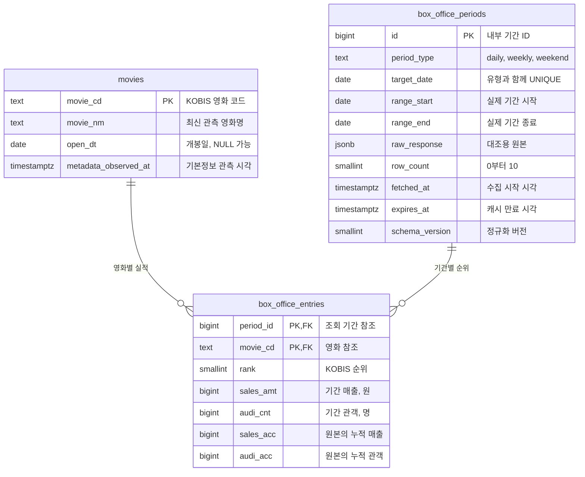

# 박스오피스 데이터 모델과 ERD

작성일: 2026-09-18 · 버전: 0.1 · 상태: Phase 5 SQL 구현·로컬 PostgreSQL 검증 / 대상 Supabase 적용·실연동 검증 완료

## 1. 설계 목적

영화 기본정보와 기간별 실적을 분리하여 같은 영화명을 날짜마다 중복 관리하는 문제를 줄인다. 조회 기간을 별도 엔터티로 두어 정상 빈 결과·수집 시각·원본 응답을 표현한다. 데이터 출처는 KOBIS지만 아래 테이블명·키·관계·정책은 우리 프로젝트에서 설계한 것이며 KOBIS 내부 DB 구조를 뜻하지 않는다.

## 2. ERD

`||`는 정확히 하나, `o{`는 0개 이상이다. 한 실적은 영화 하나와 기간 하나를 반드시 참조한다. 기간당 실적 최대 10개라는 업무 제한은 ERD 표기 외에 저장 함수에서 검증한다.

관계는 두 개의 1:N이다. 영화 하나는 여러 기간에 등장하고, 한 기간에는 여러 영화가 등장하므로 영화와 기간 사이의 N:M 관계를 entries가 연결한다. `PK`는 행을 구별하는 기본키, `FK`는 존재하는 부모 행만 참조하도록 하는 외래키다. [PostgreSQL 제약조건](https://www.postgresql.org/docs/current/ddl-constraints.html)

## 3. 테이블 명세

### movies — 영화 자체의 기본정보

| 컬럼 | 타입 | 필수 | 기본값 / 제약 | 의미 |
| --- | --- | --- | --- | --- |
| movie_cd | text | 예 | PK, 공백 문자열 금지 | 숫자 계산용 값이 아닌 외부 식별자 |
| movie_nm | text | 예 | 공백 문자열 금지 | 최신 관측 이름; 영화명에 UNIQUE를 걸지 않음 |
| open_dt | date | 아니오 | NULL | 미상·빈 값은 파싱 후 NULL |
| metadata_observed_at | timestamptz | 예 | 수집 시작 시각 전달 | 더 오래된 요청의 기본정보 덮어쓰기 방지 |

관측 시각이 더 최신인 응답만 기본정보를 갱신한다. 이는 KOBIS가 제공한 공식 수정 시각이 아니라 우리 서버가 수집한 시각이다. 과거 날짜를 나중에 조회해도 이름이 관측될 수 있으므로 “최신 공식 명칭”을 보장하지 않고 “최신 관측 기본정보”로 정의한다.

### box_office_periods — 조회 단위와 캐시

| 컬럼 | 타입 | 필수 | 기본값 / 제약 | 의미 |
| --- | --- | --- | --- | --- |
| id | bigint | 예 | PK, generated identity | 내부 참조용 ID |
| period_type | text | 예 | daily/weekly/weekend CHECK | 기간 종류 |
| target_date | date | 예 | 유형과 복합 UNIQUE | 일간 날짜 또는 해당 주 월요일 |
| range_start | date | 예 | range_start <= range_end | 실제 조회 기간 시작 |
| range_end | date | 예 | 아래 기간 규칙 검증 | 실제 조회 기간 종료 |
| raw_response | jsonb | 예 | JSON object | API 키·요청 URL 없는 성공 응답 |
| row_count | smallint | 예 | 0~10 CHECK | 저장 실적 수, 함수에서 일치 보장 |
| fetched_at | timestamptz | 예 | 서버의 수집 시작 시각 | 응답 완료 순서 역전을 판별할 기준 |
| expires_at | timestamptz | 예 | fetched_at보다 이후 | 원본 성공 후 계산하는 만료 시각 |
| schema_version | smallint | 예 | 기본 1, 양수 CHECK | 저장 형식 변경 감지 |

기간 규칙: daily는 target_date = range_start = range_end. weekly는 target_date가 월요일, 시작=target_date, 종료=target_date+6일. weekend는 target_date가 월요일, 시작=target_date+4일, 종료=target_date+6일이다. API `showRange`가 규칙과 다르면 저장하지 않고 계약 검증 오류로 처리한다. 미래·미완료 기간 검증은 요청 시 KST 기준으로 수행한다.

`UNIQUE(period_type, target_date)`는 같은 주의 서로 다른 날짜로 요청해도 같은 기간이 되도록 한다. MVP는 전국·전체 영화·최대 10개 조건만 사용한다. 지역/국가 등의 필터가 추가되면 캐시 키에도 반드시 포함해야 한다.

### box_office_entries — 특정 기간의 영화 실적

| 컬럼 | 타입 | 필수 | 기본값 / 제약 | 의미 |
| --- | --- | --- | --- | --- |
| period_id | bigint | 예 | 복합 PK, periods.id FK | 조회 기간 |
| movie_cd | text | 예 | 복합 PK, movies.movie_cd FK | 영화 |
| rank | smallint | 예 | 1~10 CHECK | 원본 순위, 매출 순위로 재작성하지 않음 |
| sales_amt | bigint | 예 | 입력 필수 | 해당 기간 매출 |
| audi_cnt | bigint | 예 | 입력 필수 | 해당 기간 관객 |
| sales_acc | bigint | 예 | 입력 필수 | 그 응답에 기록된 누적 매출 |
| audi_acc | bigint | 예 | 입력 필수 | 그 응답에 기록된 누적 관객 |

실적에 영화명·개봉일·기간 유형·날짜를 중복 저장하지 않는다. 금액/관객의 누락이나 비정상 문자열을 0으로 바꾸지 않는다. 정수 여부와 앱의 안전한 정수 범위를 검사한다. 원본 정정에서 음수가 나올 수 있는지 실키 연동 시 확인하고, 확인 전 비음수 DB 제약을 임의로 가정하지 않는다. 관객 합계가 0 이하이면 보조 비율은 표시하지 않고 0 미만은 데이터 주의 상태로 구분한다.

추가 인덱스: entries.movie_cd(영화별 기간 검색). 복합 PK의 선두 period_id는 기간 조회에 사용한다. 영화명 검색은 최대 10개 조회 결과 안에서 처리하므로 이름 검색 인덱스는 만들지 않는다.

삭제 규칙: 기간 삭제 시 해당 실적은 ON DELETE CASCADE, 영화 삭제는 실적이 남아 있으면 RESTRICT. 일반 갱신에서 영화 행은 삭제하지 않는다. 키 자체는 수정하지 않는다. 수동 삭제 기능이나 자동 정리 작업은 이번 구현 범위가 아니다.

## 4. 정규화 적용 순서

처음에는 다음과 같은 한 표를 상상할 수 있다.

`기간ID, 날짜, 유형, 수집시각, 영화코드, 영화명, 개봉일, 순위, 매출, 관객`

1. **1정규형:** 영화1·영화2 같은 반복 컬럼 대신 영화별 실적 한 건을 행으로 표현한다. 원본 JSON 보관 자체가 잘못이라는 뜻은 아니다. 조회용 관계 모델의 속성을 이렇게 분리했다.
2. **2정규형:** 실적의 복합키 `(기간ID, 영화코드)` 중 영화코드에만 의존하는 이름·개봉일은 movies로, 기간ID에만 의존하는 날짜·수집시각은 periods로 옮긴다. 순위·매출·관객은 두 키가 함께 있어야 결정된다.
3. **3정규형:** 조회 모델에서 비키 속성이 다른 비키 속성을 통해 결정되는 불필요한 종속을 만들지 않는다. 예를 들어 entries에 영화코드와 영화명을 함께 두면 영화명 갱신이 여러 실적 행에 퍼지므로 기본정보는 movies에서 관리한다. 이 예에서는 2정규형 분해로 주요 종속이 함께 해소된다.

함수적 종속은 `movie_cd → movie_nm, open_dt`, `period_id → 기간 속성`, `(period_id, movie_cd) → 실적`이다. periods의 `(period_type, target_date)`도 후보키다. 기간 종료일·row_count와 raw_response는 운영·검증을 위해 의도적으로 보관하는 파생/중복 정보다. 이를 무조건 “중복이 전혀 없는 완전 정규화”로 간주하지 않는다.

업데이트 이상: 영화명 수정이 날짜별 여러 행에 퍼지는 문제를 줄인다. 삽입 이상: 영화 실적이 없어도 정상 빈 기간을 저장할 수 있다. 삭제 이상: 특정 기간의 실적을 지워도 영화 기본정보가 함께 사라지지 않는다.

## 5. 작은 예시 — 모두 가상 데이터

movies에는 `DEMO_A / 데모 영화 A`, `DEMO_B / 데모 영화 B` 두 행이 있다. 아래 ID 101~103은 이해를 위한 예시이며 실제 identity 값이 아니다.

| 기간 ID | 유형 | 기준일 | row_count |
| --- | --- | --- | --- |
| 101 | daily | 2026-09-01 | 2 |
| 102 | daily | 2026-09-02 | 1 |
| 103 | daily | 2026-09-03 | 0 |

| period_id | movie_cd | rank | sales_amt | audi_cnt |
| --- | --- | --- | --- | --- |
| 101 | DEMO_A | 1 | 100000 | 10 |
| 101 | DEMO_B | 2 | 60000 | 6 |
| 102 | DEMO_A | 1 | 80000 | 8 |

설명을 위해 누적값·원본·시각 컬럼은 표에서 생략했다. 영화 A의 이름은 movies 한 행에 있고, 실적은 두 날짜에 각각 존재한다. 103은 정상 빈 결과라 기간 행만 있다. 기간 행 자체가 없으면 아직 수집하지 않은 상태다. 102에 영화 B가 없다는 것은 Top 10에 관측되지 않았다는 의미이며 매출 0이라는 뜻은 아니다.

101~102 두 날짜의 관측 매출 합계는 240000원, 관객은 24명, 원/명은 10000이다. 기간 순위는 A 180000원, B 60000원이다. 103을 포함한 기간은 빈 날짜가 있어 PRD 정책상 기간 합계를 숨긴다.

## 6. JOIN과 최신 기본정보 정책

기간에서 entries로 LEFT JOIN하고, 각 entry의 movie_cd로 movies를 연결한다. 빈 기간도 부모 행이 남아 있어야 한다. 일간 기간 필터로 데이터를 가져와 영화 코드별 매출을 합치면 인사이트 계산에 사용할 수 있다. 일간과 주간을 같은 합계에 섞지 않는다.

캐시는 한 SQL statement에서 기간·실적·영화를 읽어 응답을 구성한다. 영화명은 movies의 최신 관측 이름을 사용한다. 옛 원본의 이름과 다를 수 있으므로 원본 대조는 코드·순위·실적·행 수·합계로 무결성을 판단하고, 기본정보 차이는 별도 정보로 보고한다. 과거 명칭 그대로 재현하는 기능은 이번 범위에서 제외한다.

## 7. 저장 트랜잭션과 동시성

서버가 외부 응답을 검증한 후 DB 함수 `save_box_office_period`를 한 번 호출한다. 아래 동작은 supabase/migrations/202609200001_box_office.sql에 구현했다.

1. 같은 `(period_type, target_date)` 저장끼리 DB 트랜잭션 잠금으로 직렬화한다. 아직 기간 행이 없는 최초 요청도 직렬화해야 하므로 키 기반 transaction advisory lock을 사용한다.
2. 기존 fetched_at이 입력 시각 이상이면 입력 전체를 건너뛰고 현재 버전을 반환한다. fetched_at은 외부 요청 시작 때 정해 완료 순서가 뒤집혀도 오래된 요청이 이기지 않게 한다.
3. 입력 구조, 중복 코드, 최대 개수와 실제 기간을 DB 함수에서도 검증한다. movies를 영화 코드 순서로 upsert해 여러 기간 동시 저장의 잠금 순서를 일정하게 한다. 기본정보는 metadata_observed_at이 더 최신일 때만 교체한다.
4. periods의 ID를 유지하며 원본·기간·row_count·시각을 갱신한다. 해당 기간의 기존 entries를 제거하고 검증된 새 실적을 넣는다. 단순 upsert만 하면 Top 10에서 빠진 영화가 남으므로 전체 교체가 필요하다.
5. row_count와 저장한 실적 수가 일치하는지 확인한다. 오류가 나면 예외를 다시 발생시켜 영화·기간·실적 변경을 모두 롤백한다. 정상 빈 결과는 같은 방식으로 실적 0건을 저장한다.
6. 커밋 후 일관된 단일 조회로 원본과 실적을 대조한다. 그 사이 더 최신 저장이 완료되면 최신 원본/실적끼리 검증하고 원래 요청이 대체됐음을 기록한다.

행 수와 자식 개수의 일치는 단일 행 CHECK로 보장할 수 없으므로 저장 함수 책임으로 둔다. DB 함수는 SECURITY INVOKER, 명시적 스키마 경로를 사용하고 PUBLIC/anon/authenticated의 실행 권한을 제거한 뒤 서버 역할에만 허용한다. 세 테이블 모두 RLS를 활성화하며 브라우저 직접 접근을 허용하지 않는다. 구체적인 migration·권한 검사는 구현 단계에서 수행한다. [Supabase 함수와 실행 권한](https://supabase.com/docs/guides/database/functions)

제한: fetched_at은 서버 관측 시각으로 원본의 공식 수정 버전이 아니다. 여러 서버의 시각이 충분히 동기화되어 있다는 데모 운영 가정을 둔다. DB 커밋 직후 네트워크 timeout이면 실제 저장 여부가 불확실할 수 있으며, 사용자에게 확인 미완료로 표시하고 다음 조회로 확인한다. 잠금은 저장만 보호하며 중복 외부 API 호출까지 막지는 않는다.

## 8. 구현 단계에서 실행할 DB 검증

- AC13: 없는 영화/기간 참조, 동일 기간·영화 중복, 중복 기간 키를 거부하는지 확인.
- AC13: 정상 빈 기간은 부모 1행·자식 0행이며 미수집과 구분되는지 확인.
- AC14: 저장 도중 의도적 오류로 세 테이블 모두 기존 상태를 유지하는지 확인.
- AC14: 기존 10개가 새 8개/0개로 바뀌면 제외된 실적이 남지 않는지 확인.
- AC14: 최초 기간 동시 생성·오래된 요청 늦은 완료·다른 기간의 동일 영화 갱신을 검증.
- AC09: 최신 영화명 갱신이 과거 실적 수치 변조로 오인되지 않는지 확인.
- AC11: anon/authenticated가 테이블 조회·쓰기와 저장 RPC를 호출할 수 없는지 확인.

로컬 PostgreSQL 실행 결과는 docs/verification/phase-05.md를 따른다. 대상 Supabase 실연동은 대기 중이다. 관련 결정은 ADR-009, 요구사항은 PRD AC01~AC14를 따른다.
